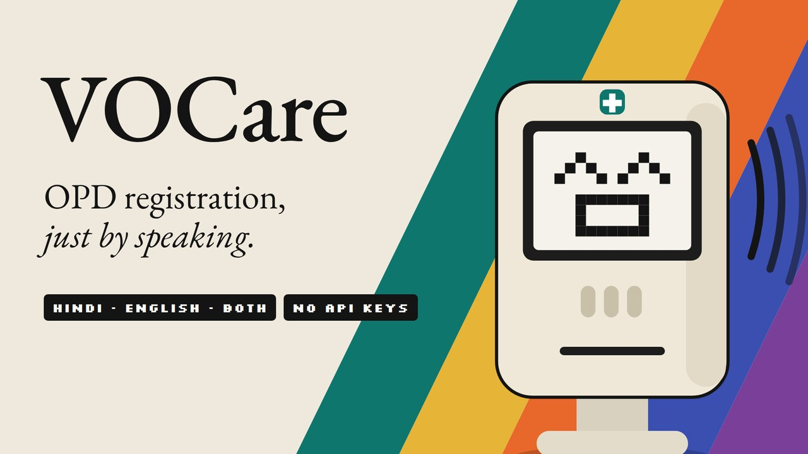
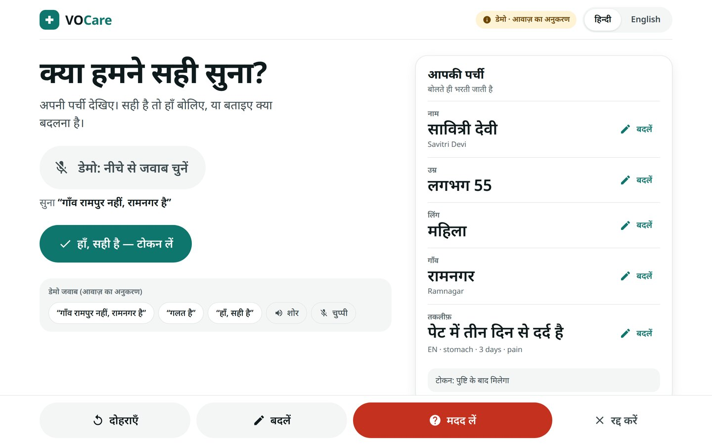
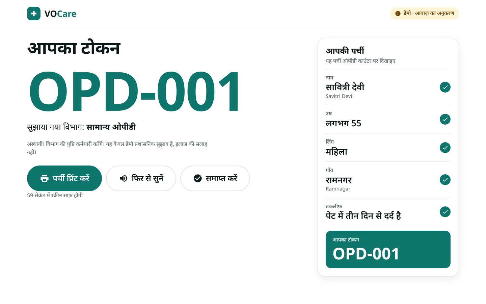
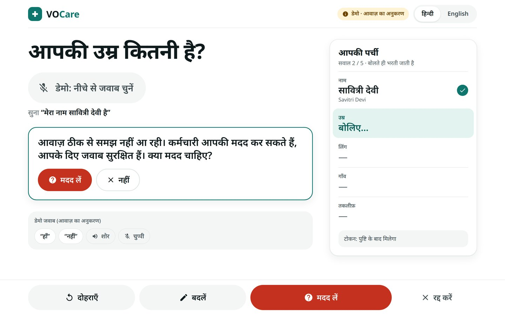
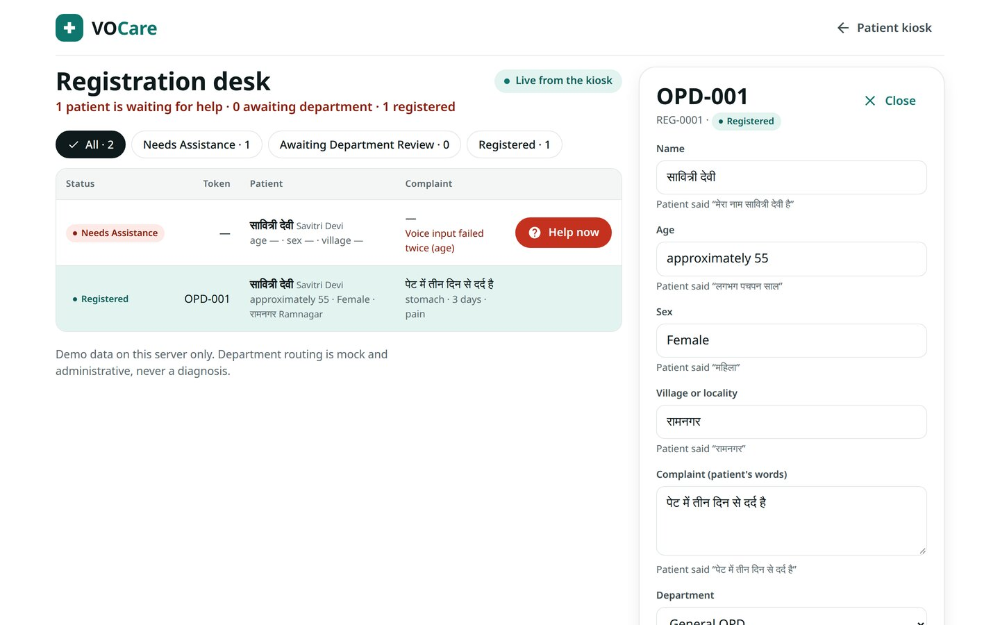
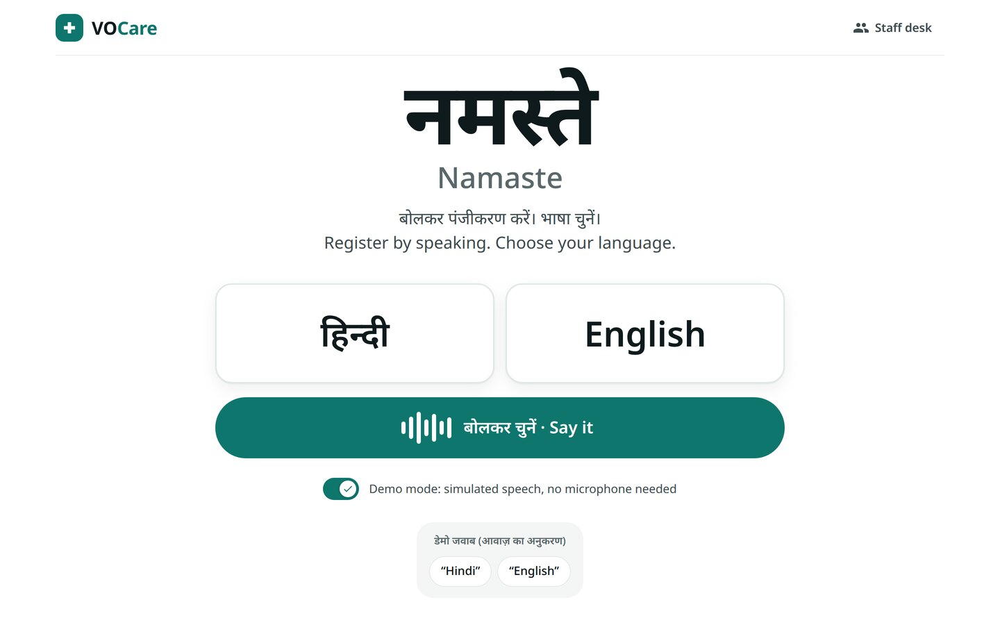
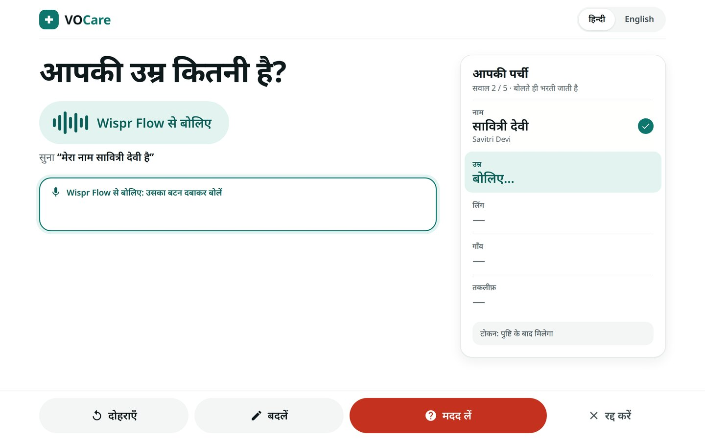

<p align="center"></p>

<p align="center">
  <a href="https://vocare.gaurishhs.xyz"><b>Try the kiosk</b></a> ·
  <a href="https://vocare.gaurishhs.xyz/#staff"><b>Staff desk</b></a> ·
  <a href="docs/VOCare-pitch-deck.pdf"><b>Pitch deck (PDF)</b></a>
</p>

<p align="center">
  
  
  
  
  
</p>

# VOCare

A voice-first OPD registration kiosk for a government hospital. A patient speaks their name, age, sex, village and problem in Hindi, English or a mix of the two, hears it read back, corrects anything that was misheard and gets a token. They never type. A staff dashboard on any other device sees each registration and help request as it happens.

| Speak, then fix by voice | Token and slip |
|---|---|
|  |  |
| **Two failures, then a person** | **Staff desk, live** |
|  |  |

<sub>Real screens from the app in demo mode. The patient, Savitri Devi from Ramnagar, is fictional.</sub>

## Run

```sh
docker compose up --build
```

Open **http://localhost:3000**. The staff dashboard is at **http://localhost:3000/#staff** (open it in another tab or on another device on the same network).

No API keys, no `.env` file and no model downloads are needed. `.env.example` lists the optional settings. Records are kept in a Docker volume; `docker compose down -v` removes them.

Without Docker, with Go 1.23 or newer:

```sh
go run ./server          # serves dist/ on :3000
go test ./server         # store, tokens, department rules
node --test test/*.mjs   # speech parsing (Node 20+)
```

## Try it



Switch on **Demo mode** on the welcome screen to use buttons that stand in for speech. They are labelled as simulated, and each one is passed through the same parser as live speech.

1. **Hindi registration.** Tap हिन्दी, then the demo answers in order: हाँ → “मेरा नाम सावित्री देवी है” → “लगभग पचपन साल” → “महिला” → “रामपुर” → “पेट में तीन दिन से दर्द है”. The kiosk shows *Name: सावित्री देवी (Savitri Devi)*, *Age: लगभग 55*, *Sex: महिला (Female)*, and keeps the complaint word for word.
2. **Village correction.** On the review screen pick “गाँव रामपुर नहीं, रामनगर है”. Only the village changes, the kiosk says “गाँव अब रामनगर है। क्या अब सब सही है?”, and “हाँ, सही है” issues OPD-001.
3. **Edge cases (English).** “Savitri Devi · unclear accent” is read back for confirmation. “Pata nahi” for age asks again. “Age sixty hai” is 60. “Sultanpur” asks for the district. “Galat hai” asks which detail to change.
4. **Failures.** Press *Background noise* twice, or *Silence*. Noise repeats only the current question; silence offers more time; a second failure offers staff help and sends what was already given to the dashboard as *Needs Assistance*.
5. **Staff.** On `#staff`, correct any detail, confirm the department and print the slip. The status becomes *Registered*.

With demo mode off, Chrome or Edge on localhost (or HTTPS) listens through the microphone after every prompt.

**Wispr Flow fallback.** Browser speech recognition needs Google's online service, which often fails on Linux and Brave ("network" error). When it does, the kiosk says so once and shows a dictation box instead. Hold your [Wispr Flow](https://wisprflow.ai) key and speak: Flow types your words into the box, and after a short pause the kiosk handles them exactly like live speech (corrections, readback and all). Any system dictation works the same way. You can say “दोबारा” or “repeat”, “मदद” or “help”, and “गलत है”, or use the buttons at the bottom of the screen.



## How it works

```
dist/          static kiosk + staff app (no build step, no framework)
  app.js       conversation state machine, voice loop, screens, staff desk
  parse.js     turns speech into fields: names, Hindi/English number words,
               corrections, yes/no/help/repeat, a complaint glossary
  text.js      every prompt in English and Hindi, plus the demo utterances
server/        Go standard library only
  main.go      static files, JSON API, Server-Sent Events for the dashboard
  store.go     records, sequential tokens, mock department rules, JSON file
```

- **Speech** uses the browser's Web Speech API: `SpeechRecognition` (hi-IN / en-IN) and `speechSynthesis`. The kiosk shows whether it is listening, processing or speaking.
- **Nothing is guessed silently.** Low-confidence results are treated as noise and never fill a field. Names and places heard with medium confidence are read back first. Age keeps “approximately”. Village names are stored as spoken, and Devanagari names get an automatic Latin spelling *next to* the original, never in place of it.
- **One registration per patient.** Each kiosk session has an ID, and the server returns the existing token if a confirmation is repeated.
- **Department routing is mock and administrative.** Only explicit requests (“dentist”, “ENT doctor”) suggest Dental or ENT; everything else is General OPD for staff to review. There is no diagnosis, treatment advice or waiting time.
- **Privacy.** No audio is recorded or stored. The kiosk clears itself after Finish or Cancel, 60 seconds after showing a token, and after 90 seconds without activity (with a spoken warning). No phone number, email or Aadhaar is asked for.

## Dependencies and fallbacks

| Depends on | If it becomes costly or stops working |
|---|---|
| Browser speech recognition (Chrome sends audio to Google; Firefox has none) | Falls back to Wispr Flow (or OS dictation) typing into the kiosk's dictation box; demo mode and touch controls still work. Next step: an on-premise Indian-language model (AI4Bharat IndicConformer, or Vosk for Hindi) behind the same `handle(text, confidence)` entry point. |
| Browser text-to-speech voices | Every prompt is also on screen; a missing voice skips speech without stalling. Pre-recorded prompt audio is a cheap replacement. |
| Go server + JSON file | Runs on any small machine in the hospital LAN with no internet. |

## Prototype limits

Fictional data only. There is no staff login, no hospital system integration and no backup. The number-word list, district list and complaint glossary are small demo lists. A real pilot needs supervised testing with regional accents, a noise-cancelling microphone, authenticated staff access and an agreed retention policy.
